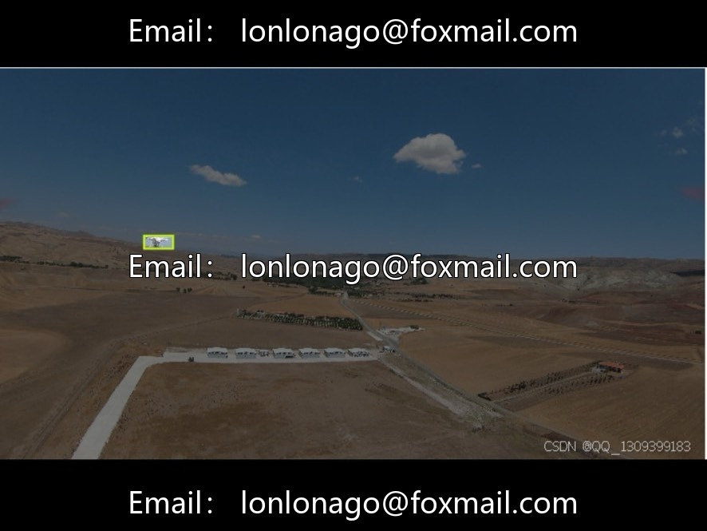
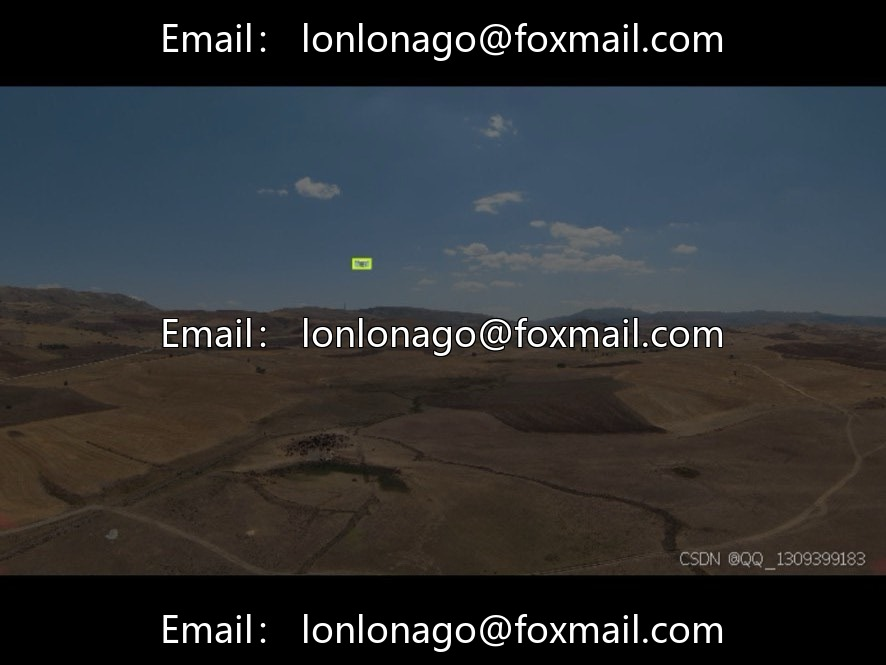
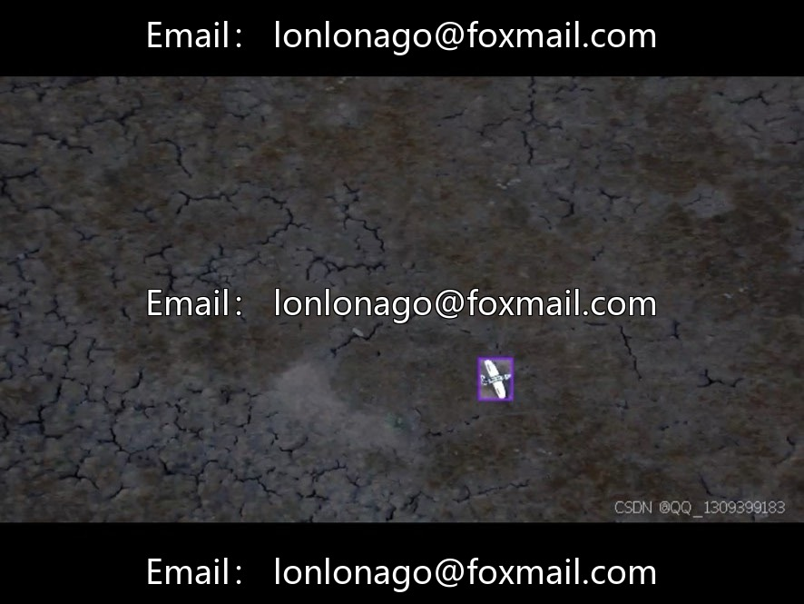
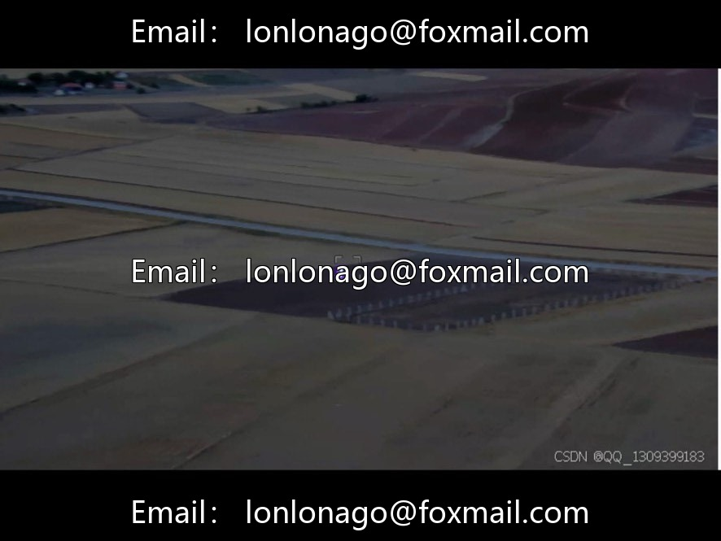
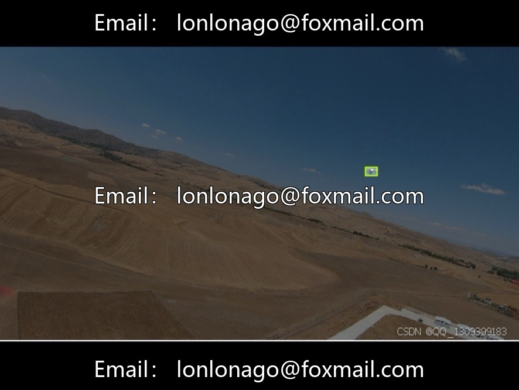
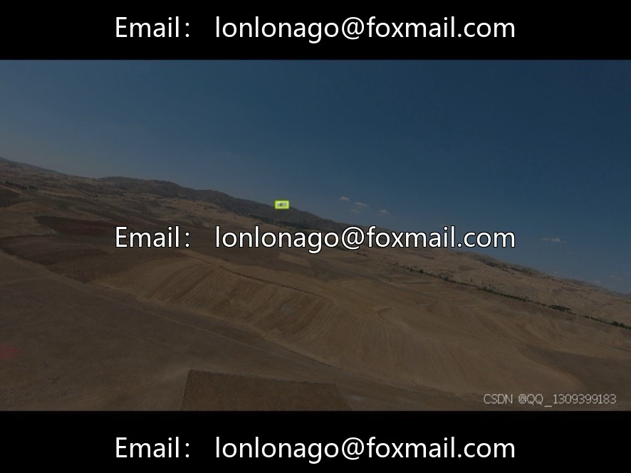

# Aerial Vehicle Target Detection Dataset | Issue 10048 (DJI Series)

## Body

Aerial Vehicle Identification Target Detection Dataset | Issue 10048 (DJI Series)
Targeted for low-altitude security and anti-drone scenarios, this dataset is designed for the detection of aerial drones and fixed-wing aircraft using visible light.

1. Basic scale
A total of 1900 structured aerial imagery, packaged into a single complete dataset file, which can be directly imported into detection frameworks such as YOLO. Coverage of complex aerial environments such as day and night, sunny and rainy, and from multiple angles, with data collection relying on DJI equipment, ensuring stable imaging quality.

II. Two Types of Annotation Objectives
1. Drone (Multi-rotor Vehicle)
2. Fixed-wing Aircraft

III. Dataset Splitting Plan
There is no official fixed split, industry-wide allocation scheme: 8:2, 7:3 or 6:2:2; the training set accounts for the main samples for feature learning, the validation set tunes parameters, and the test set independently evaluates the model generalization, users can re-split as needed.

IV. Image Resolution
Includes 1280×720, 1920×1080 high-definition images, and some 2K/4K high-resolution samples; adapts to distant airborne small target recognition and inference for embedded low-altitude monitoring devices at multiple scales.

V. Core Application Scenarios
1. Low-altitude security and anti-drone: Airport, industrial parks, key areas for airspace monitoring, identification of unauthorized flying aircraft
2. Drone autonomous obstacle avoidance: Visual payloads for aerial pesticide spraying and inspection drones to avoid other airborne vehicles in the sky
3. Airspace control system: City low-altitude comprehensive surveillance, statistics on aircraft activities and abnormal warnings
4. Algorithm research benchmarks: Training and evaluation materials for models like YOLO and Faster R-CNN targeting small targets in the air
5. Robotics/aerial vision: Training for sensor modules in various intelligent aerial and ground devices

Virtual materials, once sold, are non-refundable.
Interested friends, click "I want" to proceed.

## Images

## Payment

Here is a pay link on Stripe ( https://buy.stripe.com/3cs8yP7sY87d0vu9AB ). Please contact me lonlonago@foxmail.com after funding $89, and I will send you a complete data files , thank you!

